# Architecture — Aveto Support

> Owned by the Architect. This file describes the system **as it stands now**, and
> is updated each slice rather than appended to. The history of *why* lives in
> [`docs/adr/`](adr/). Per-slice detail lives in `runs/<slice-id>/`.
>
> **Current as of:** docs-answerability-2, stage 10b (2026-10-16), on
> branch `claude/docs-answerability-2`, **not merged**. Retrieval is the hybrid
> ranking of [ADR 0003](adr/0003-hybrid-embedding-retrieval.md) at file level
> ([ADR 0004](adr/0004-file-level-ranking-and-fixed-corpus.md)), default
> `file-rrf-v1` ([ADR 0006](adr/0006-default-rrf-reranker-opt-in.md)). This
> branch also carries an **attended answerability judge step** (`judge-input`,
> `judge-apply`, `eval --verdicts`, the `/aveto-judge` skill), proposed in
> [ADR 0008](adr/0008-operator-run-answerability-judge.md). Both registered
> judge bars were met once (seen-set sample and fifth gate set; figures under
> "Safety stance"). The owner ruled the release tier 3 on 2026-10-16
> (`runs/docs-answerability-2/APPROVAL_RECORD-9.md`); the tier 3 verdict is
> **GO WITH CONDITIONS** (internally releasable candidate, not announced, not
> cleared to land; conditions T1 to T11 are the owner's or a named role's to
> resolve; see `runs/docs-answerability-2/13-release-checklist-tier3.md`).
> Nothing is released or announced. The INV-4 and INV-5
> words that cover it are approved and live in `.agentic/SAFETY_INVARIANTS.md`.
> Tech specs: `runs/docs-retrieval/02-tech-spec.md` (retrieval);
> `runs/docs-answerability-2/02-tech-spec.md` (the judge step).

## What exists

Aveto Support will be a support agent that drafts grounded replies to GitHub
issues and Discussions from a product's own docs, and never posts without a
person's approval. Today, only **step 2 of the pipeline, retrieval, exists**, as a
command-line tool, plus, on this branch, an **attended judge step** that can turn
a retrieval result into `no confident match`. It has no server and no database.

The program runs **only local, non-generative models**: a small embedding model
on the CPU, and optionally a cross-encoder reranker. They rank passages and never
write text. The judge step's model is **not run by the program**: it is a
subagent in the operator's own Claude Code session, which returns one verdict
token that the program applies.

```
                    ┌──────────────── today ───────────────────────────────────────────────┐
question ─► [1 classify] ─►│ [2 retrieve] ─► RetrievalResult (top 5 files, passages, top score)   │─► [3 draft] ─► [4 check] ─► [5 person approves] ─► post
             not built     │      └─► [2b judge step, attended, operator's session; this branch] │    not built     not built      not built
                           │           ─► same output, or `no confident match`                    │
                           └──────────────────────────────────────────────────────────────────────┘
```

## Components

| Component | Module | Responsibility |
|-----------|--------|----------------|
| CLI | `aveto_support/__main__.py` | `ingest`, `retrieve`, `eval` (with optional `--verdicts`), `judge-input` and `judge-apply` subcommands, and the exit codes (0 ok, 1 eval below 80%, 2 input, 3 fetch, 4 judge error, `judge-apply` only). It pins numeric libraries to one thread for determinism and has no logic of its own |
| Ingest | `aveto_support/ingest.py` | **All network code.** Fetches the pinned GitHub docs archive and the pinned model files, verifies the archive commit and every model file's sha256 **before use**, reads `.md` files in memory, and orchestrates index building |
| Index | `aveto_support/index.py` | Splits markdown into heading passages with exact line ranges, and serialises and loads the canonical JSON index (`index@3`: passages plus int8 embeddings) |
| Embed | `aveto_support/embed.py` | **The model adapter boundary.** The `Embedder` protocol; `OnnxEmbedder` (`BAAI/bge-small-en-v1.5` at revision `5c38ec7c…`, ONNX Runtime on CPU); `PlaceholderEmbedder`, which throws by default; plain-Python WordPiece; int8 quantisation |
| Search | `aveto_support/search.py` | Lexical ranking (v2: Porter stemming, passage + file BM25), dense ranking, Reciprocal Rank Fusion, reference-similarity calibration (diagnostic), and `retrieve()` |
| Rerank | `aveto_support/rerank.py` | **The second model adapter boundary, optional.** `OnnxReranker` (`cross-encoder/ms-marco-MiniLM-L6-v2`, pinned revision and sha256s, ONNX Runtime on CPU) returns one float per question/passage pair and never text; `PlaceholderReranker` throws by default. It is used only with `--ranking file-rerank-v1`; absent files fail closed (exit 2), nothing is downloaded by `retrieve` or `eval` |
| Evaluate | `aveto_support/evaluate.py` | Scores retrieval against an eval file (`--eval-file`) using integer ≥80% thresholds |
| Judge (offline half) | `aveto_support/judge.py` | **This branch.** Builds the judge payload from `retrieve`'s result at the default ranking (question, then each shown file and passage in full with heading and line range; no scores, URLs or commit) and its sha256; parses a reply (`parse_verdict`: last non-empty line, `Q1 <TOKEN>` with an optional colon and reason, fail closed on any control or format character, keeps the token only); renders the applied result; handles the transport files in `.aveto-judge/` (gitignored, deleted on every `judge-apply`). Calls no model, opens no socket, starts no process |
| Judge scoring | `aveto_support/judge_eval.py` | **This branch.** `eval --verdicts <file>`: reads a verdicts file (one token per eval question, bound by payload sha256 and prompt sha256) and prints the two abstention bars, judge errors, hard negatives and the end-to-end figure. The `eval` exit code stays the retrieval gate |
| Judge agent and skills | `.claude/agents/aveto-answerability-judge.md`, `.claude/skills/aveto-judge/`, `.claude/skills/aveto-judge-seen/`, `prompts/answerability-judge-v1.txt` | **Not part of the program; run by Claude Code.** The agent pins `claude-sonnet-5-5`, has no `tools` entry, a deny list ending in `mcp__*` and a hook that refuses every tool call; its prompt is hash-pinned. `/aveto-judge` (operator path) runs only when the operator types it. `/aveto-judge-seen` (eval only) is a forked skill whose helper injects the payload for a run id listed in its key file and refuses anything else |

**Configuration** lives in `docs-source.toml`: the docs repo and its full
40-hex commit, plus an `[embedding]` table holding the model repo, revision and
per-file sha256, and the path and sha256 of the frozen off-topic calibration
list.

**Generated and gitignored:** the index at `index/docs-index.json`, and the
model cache at `models/BAAI--bge-small-en-v1.5/<revision>/`.

**Committed eval and calibration inputs:**

- `evals/retrieval.toml`, the dev-set diagnostic
- `evals/calibration-offtopic.toml`, written by QA, frozen and pinned by sha256,
  and never read by the roles that build retrieval
- the owner's fresh held-out set, which gates the ≥80% bar and is committed
  only after the implementation is frozen

**Ranking modes and model lifetime (slice docs-retrieval-4).** The default ranking is
`file-rrf-v1`, the first stage alone, which needs only the embedding model.
`--ranking file-rerank-v1` re-scores its top 20 files with the reranker and needs
`ingest --with-reranker` first; by default `ingest` fetches only the embedding model's
files, so the default path loads no reranker file. The index is byte-identical either way.
Whoever loads an ONNX adapter closes it (`close()`, reranker before embedder) in a
`finally` before the process ends, so no inference session is left to interpreter
teardown; adapters injected by a caller are the caller's to close.

## Data flow

```mermaid
flowchart LR
  cfg[docs-source.toml<br/>docs repo + commit · model + revision + sha256 · off-topic list sha256] --> fetch
  cfg --> mfetch
  subgraph ingest [ingest - the only network access]
    fetch[fetch_archive<br/>HTTPS github.com → codeload.github.com] --> read[read_markdown<br/>in memory, commit-checked, .md only]
    mfetch[fetch model files<br/>HTTPS huggingface.co → *.hf.co<br/>sha256 checked before use] --> emb
    read --> split[split_passages<br/>ATX heading sections, exact line ranges]
    split --> emb[embed passages<br/>ONNX CPU, 1 thread, batch 1, int8]
    emb --> cal[calibrate τ = max of<br/>word-salad p90 and off-topic p90]
    off[evals/calibration-offtopic.toml<br/>QA-written, frozen, hash-pinned] --> cal
    cal --> write[write_index<br/>canonical JSON, atomic, sha256]
  end
  write --> idx[(index/docs-index.json<br/>generated file, not a DB)]
  idx --> retrieve
  q[question] --> retrieve[retrieve - offline<br/>RRF of lexical + dense · never abstains]
  retrieve --> hits[top 5 files, best passages<br/>path · heading · lines · permalink · top score]
  idx --> evalc[eval - offline]
  evals[eval file via --eval-file<br/>fresh held-out set gates · dev set diagnostic] --> evalc
  evalc --> score[answerable · unanswerable<br/>exit 0 pass / 1 miss]
  subgraph judge [judge step - this branch, attended]
    jin[judge-input - offline<br/>payload of retrieve's result + sha256] --> sess
    sess[operator's Claude Code session<br/>/aveto-judge, typed by the operator] --> agent[aveto-answerability-judge<br/>claude-sonnet-5-5 · deny list + refuse-all hook]
    agent --> reply[reply text<br/>.aveto-judge/reply.txt]
    reply --> japp[judge-apply - offline<br/>sha256 binding · last-line token only]
  end
  idx --> jin
  q --> jin
  sess -. question, payload, reply, session context .-> provider[(model provider of<br/>the operator's session)]
  japp --> jout[ANSWERABLE: retrieve output + signal line<br/>NOT_ANSWERABLE: no confident match + signal line<br/>unusable reply: judge error, exit 4]
  verdicts[verdicts file<br/>eval only] --> evalc
```



1. **`ingest`** makes the only two network requests.
   - It fetches the docs archive (`https://github.com/{repo}/archive/{commit}.tar.gz`,
     with redirects only to `codeload.github.com`) and never extracts it to
     disk.
   - It fetches two model files (`onnx/model.onnx`, `vocab.txt`) from
     `https://huggingface.co/BAAI/bge-small-en-v1.5/resolve/<revision>/…`, with
     redirects only to hosts under `hf.co`. Each file is hashed while it
     streams. On a mismatch it is deleted and ingest fails (exit 3). A cached
     file is re-hashed before every use.
   - It splits `.md` files at their ATX headings and embeds each passage (heading
     trail plus body, truncated to 512 tokens). It calibrates τ from word-salad
     nulls and from the frozen off-topic list, taking the stricter of the two,
     then writes the index atomically.
2. **`retrieve`** is **fully offline**. It embeds the question locally with
   bge's retrieval prefix, then ranks passages by Reciprocal Rank Fusion of the
   lexical list and the dense list, with at most 2 passages per file and 5 in
   total. It returns verbatim passages from the top five files, each with path,
   heading, line range and permalink, plus the top score (the best dense
   similarity). It never abstains: a question the docs do not answer still
   returns files. The ingest-time τ is printed as a reference similarity and
   decides nothing.
3. **`eval`** is fully offline. It runs every question in the given file through
   `retrieve`, prints both scores, and exits 1 if either is below 80%. With
   `--verdicts <file>` it also prints the judge's two abstention bars from a
   verdicts file; the exit code is still the retrieval gate.
4. **The judge step** (this branch; ADR 0008, proposed) runs
   only when the operator types `/aveto-judge <question>` in their own Claude
   Code session:
   - `judge-input` (offline) prints the payload: the question and the passages
     `retrieve` would show at the default ranking, in full, with path, heading
     and line range. Its sha256 goes to stderr. The operator can run it alone
     to inspect what would be sent.
   - The session passes the payload to the `aveto-answerability-judge`
     subagent, which replies with one line `Q1 ANSWERABLE` or
     `Q1 NOT_ANSWERABLE`, optionally with a short reason.
   - `judge-apply` (offline) re-derives the payload, refuses a reply bound to a
     different payload, keeps only the token from the reply's last non-empty
     line, deletes the transport files, and prints `retrieve`'s output plus a
     deciding-signal line (`ANSWERABLE`), or `no confident match` plus that
     line (`NOT_ANSWERABLE`), or `judge error` with exit 4.
   - **Data leaves the machine here, through the operator's session, not the
     program:** the question, the payload, the reply and the session context the
     harness attaches go to that session's model provider. What is attached was
     measured in `runs/docs-answerability-2/01-measurement.md`, and INV-5 in
     `.agentic/SAFETY_INVARIANTS.md` states it (see Safety stance).
   - For evaluation, the forked skill `/aveto-judge-seen <run id>` has the
     harness inject the payload of a key-listed eval question, so no model
     retypes it. The eval-only tool `tools/judge_run.py` (tech spec 4.3;
     outside the package) turns replies into tokens through the product's own
     `judge-apply` and audits the transcripts; `eval --verdicts` scores them.

The reasoning is in [ADR 0003](adr/0003-hybrid-embedding-retrieval.md), which
supersedes the ranking and confidence parts of
[ADR 0002](adr/0002-lexical-retrieval-calibrated-abstention.md).

## Model adapter boundaries

- **Embedding (retrieval, step 2): real and local.** `Embedder` is a
  `Protocol`. `PlaceholderEmbedder` raises `"embedding model is not configured
  in this build."` and is the default wherever a model was not explicitly
  loaded. Unit tests use a deterministic `FakeEmbedder`, so they need no model,
  no network and no key. `OnnxEmbedder` loads only hash-verified files from the
  local cache, and **nothing it computes is ever shown as text**.
- **Generative steps: not built.** Each will sit behind a `Protocol` with a
  placeholder that raises `"<capability> LLM adapter is not configured in this
  build."` ([ADR 0001](adr/0001-python-fastapi-uv-no-agent-framework.md)):
  - **Classify (step 1)** runs *before* `retrieve()`, with rules first.
  - **Draft (step 3)** consumes `RetrievalResult` unchanged. Retrieval never
    says the docs do not answer, so the drafter cannot rely on it for that; how
    a drafter decides not to draft is open work. The attended judge step on
    this branch (below) is not wired to any drafter.
    Its bounded tool loop searches by calling `retrieve()`.
  - **Check (step 4)** uses a different model from the drafter.
- **Answerability judge (step 2b, this branch): no adapter in
  the program.** The program has no model client for it, so there is nothing to
  placeholder: `judge-input` and `judge-apply` are deterministic and offline,
  and the model runs as a subagent in the operator's own Claude Code session.
  A missing, empty or unusable reply is `judge error` (exit 4), never passages
  and never a pass-through. Tests feed reply bytes directly; they need no
  model, network or key.
- **FastAPI** routes, once an HTTP surface is needed, wrap the same service
  functions.

## Safety stance (this slice)

> The bullets below are a summary. The authoritative words are INV-4 and INV-5
> in [`.agentic/SAFETY_INVARIANTS.md`](../.agentic/SAFETY_INVARIANTS.md),
> approved by the owner under rule 4
> (`runs/docs-answerability-2/APPROVAL_RECORD-5.md`, and
> `APPROVAL_RECORD-8.md` for one INV-5 edit). Where this summary and that file
> differ, the file wins.

- **Sources, never answers (INV-4).** `retrieve` returns only verbatim passages
  and does not abstain. A model may rank passages, decide confidence, and, in
  the operator-run judge step only, return a verdict that decides whether
  `retrieve`'s whole output or `no confident match` is printed. No model
  produces, selects among or alters the text shown.
- **Provenance is always visible.** A passage can only be printed together with
  its path, heading, line range and commit permalink.
- **Not silent when the docs do not answer.** `retrieve` alone always returns
  the top files, even for a question the docs do not answer. The attended judge
  step (ADR 0008, proposed) can print `no confident match`. Recorded figures,
  each scored once, judge errors counted as failures
  (`runs/docs-answerability-2/05-seen-check.md`, `07-gate-scoring.md`):
  - seen-set sample (stage 5): Bar 1 20/20 (needed 16), Bar 2 24/28 (needed 23)
  - fifth gate set (stage 7): Bar 1 24/24 (needed 20), Bar 2 16/19 = 84.2%
    (needed 80%); judge errors 0
  - Bar 2 passed by one question of margin at both stages. End to end on the
    fifth set, 16 of 24 answerable questions show the right file after judging
    (diagnostic).

  The owner ruled the release tier 3 on 2026-10-16 (APPROVAL_RECORD-9); the
  tier 3 verdict is GO WITH CONDITIONS (internally releasable candidate, not
  announced, not cleared to land; conditions T1 to T11 are the owner's or a
  named role's to resolve; see
  `runs/docs-answerability-2/13-release-checklist-tier3.md`). The step is not
  released and not announced.
- **Bounded network surface (INV-5, amended under APPROVAL_RECORD-4).** Egress
  is limited to two read-only HTTPS GETs, both made only by `ingest`:
  - the configured docs archive at a full commit (redirects only to GitHub
    hosts), approved under APPROVAL_RECORD-1
  - the pinned model files at a full revision from `huggingface.co` (redirects
    only to `*.hf.co`), approved under APPROVAL_RECORD-3

  Trust rests on the committed sha256, checked before use, never on the host.
  No credentials are sent. **The program sends no question, passage or user
  text anywhere:** `retrieve`, `eval` (with or without `--verdicts`),
  `judge-input` and `judge-apply` make no network call and start no process
  (`test_program_offline_no_model`), and the default test suite blocks the
  network. **The operator's session is the one exception, and it is not the
  program:** when the operator runs the judge step, the question, the payload,
  the reply and the session context the harness attaches go to that session's
  model provider (Anthropic, approved as data processor under
  `runs/docs-answerability-2/APPROVAL_RECORD-3.md`, attended only). INV-5
  lists what is attached, as measured.
- **Nothing posts.** There is no GitHub write client and no credential of any
  kind (INV-1).

## How CI invokes it (built by docs-retrieval-ci)

Each of these runs as its own step, and any non-zero exit fails the build:

```sh
uv sync --locked
uv run mypy
uv run ruff check
uv run pytest                                         # offline suite
uv run python -m aveto_support ingest                 # docs + model download; exit 3 on fetch or hash failure
uv run pytest -m model                                # golden tokenizer ids, ONNX signature, repeatability
uv run python -m aveto_support eval --eval-file <gating set>   # exit 1 if either group < 80%
```

The model cache (`models/`) should be restored with `actions/cache`, keyed on the
revision and the file hashes. Cached files are still re-hashed before use. The
score is printed on the `eval` step's stdout, and CI gates on the **exit code**.

## Decisions

- [ADR 0001](adr/0001-python-fastapi-uv-no-agent-framework.md): Python 3.12 +
  uv, FastAPI for HTTP when needed, Anthropic SDK direct, no agent framework.
  *Accepted.*
- [ADR 0002](adr/0002-lexical-retrieval-calibrated-abstention.md): BM25 over
  heading passages with calibrated abstention. *Proposed; its ranking and
  confidence are superseded by 0003.* Lexical v2 remains the specified
  fallback.
- [ADR 0003](adr/0003-hybrid-embedding-retrieval.md): hybrid retrieval with a
  local `bge-small-en-v1.5` (ONNX/CPU) fused with BM25, and dense confidence.
  *Accepted; partly superseded by 0004 (passage-level ranking, dense
  confidence as a gate).* The hybrid ranking is in the code (`search.py`,
  default `file-rrf-v1`); the record's own status line still reads
  "implementation pending" and is not edited.
- [ADR 0004](adr/0004-file-level-ranking-and-fixed-corpus.md): file-level
  ranking and a fixed corpus. *Proposed (per its status line).*
- [ADR 0005](adr/0005-cross-encoder-reranker.md): cross-encoder reranker.
  *Proposed; kept, off by default, opt-in (per its status note).*
- [ADR 0006](adr/0006-default-rrf-reranker-opt-in.md): default `file-rrf-v1`,
  reranker opt-in. *Proposed (per its status line).*
- [ADR 0007](adr/0007-answerability-judge.md): abstention by a local answerability judge.
  *Rejected* (pooled Bar 1 2/20 against 16/20).
- [ADR 0008](adr/0008-operator-run-answerability-judge.md): abstention by an
  operator-run `claude-sonnet-5-5` judge, method registered before it runs.
  *Proposed; built on branch `claude/docs-answerability-2`; both registered
  bars met once (stage 5 and stage 7). Acceptance is the owner's.*
