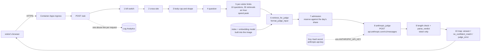

# Architecture — Aveto Support

> Owned by the Architect. This file describes the system **as it stands now**, and
> is updated each slice rather than appended to. The history of *why* lives in
> [`docs/adr/`](adr/). Per-slice detail lives in `runs/<slice-id>/`.
>
> **Current as of:** land-answerability (2026-10-17), merged to `main` in
> pull request #4 (2026-10-17). Retrieval is the hybrid
> ranking of [ADR 0003](adr/0003-hybrid-embedding-retrieval.md) at file level
> ([ADR 0004](adr/0004-file-level-ranking-and-fixed-corpus.md)), default
> `file-rrf-v1` ([ADR 0006](adr/0006-default-rrf-reranker-opt-in.md)). This
> branch also carries an **attended answerability judge step** (`judge-input`,
> `judge-apply`, `eval --verdicts`, the `/aveto-judge` skill), proposed in
> [ADR 0008](adr/0008-operator-run-answerability-judge.md). Both registered
> judge bars were met once (seen-set sample and fifth gate set; figures under
> "Safety stance"). Release tier 3, by the owner's ruling of 2026-10-16
> (`runs/docs-answerability-2/APPROVAL_RECORD-9.md`). Slice docs-answerability-2
> closed as an internal candidate; its T items are carried by
> `land-answerability`. Merged by pull request #4 (2026-10-17). Not
> announced. The S5 finding is fixed in this slice and the S6 rule was deleted
> (owner, 2026-10-16). Operating rule (Charter C4.1): public-docs questions only
> until a DPA is in place; personal subscription, no DPA. The INV-4 and INV-5
> words that cover it are approved and live in `.agentic/SAFETY_INVARIANTS.md`.
> Tech specs: `runs/docs-retrieval/02-tech-spec.md` (retrieval);
> `runs/docs-answerability-2/02-tech-spec.md` (the judge step).
>
> **The public ask-the-docs service**, package `aveto_service`, sits beside the
> unchanged program: a page and `POST /ask` that return `retrieve`'s verbatim
> passages or `no confident match`, judged through the Anthropic Messages API,
> under fixed limits, on Azure Container Apps
> ([ADR 0009](adr/0009-public-ask-service-on-azure-container-apps.md),
> proposed). Built in `runs/public-ask-the-docs/`, corrected in
> `runs/fix-service-accounting/` (live as revision `ca-aveto-ask--0000008`,
> 2026-10-24, per the runbook). See "Public ask service".
>
> **Slice `polished-chat-experience` (2026-10-26, specified, not yet built or
> deployed when this was written)** changes only the experience around the
> answering: answer and refusal cards rendered once on the server
> ([ADR 0010](adr/0010-server-rendered-results-one-renderer.md)), suggested
> questions, a warm-up, a resting state on page load, a receipts drawer, a
> scorecard page from recorded figures and content-free counts
> ([ADR 0011](adr/0011-content-free-counts-and-recorded-figures-scorecard.md)).
> The service is not framed by aveto.dev
> ([ADR 0012](adr/0012-service-not-framed-aveto-dev-links-to-it.md)).
> Tech spec: `runs/polished-chat-experience/05-tech-spec.md`.

## What exists

Aveto Support will be a support agent that drafts grounded replies to GitHub
issues and Discussions from a product's own docs, and never posts without a
person's approval. Today, only **step 2 of the pipeline, retrieval, exists**, as a
command-line tool, plus, on this branch, an **attended judge step** that can turn
a retrieval result into `no confident match`. The program has no server and no
database. On branch `claude/public-ask-the-docs`, a separate package,
`aveto_service`, puts the same retrieval and the same judge prompt and parser
behind a public HTTPS page (see "Public ask service"); it has no database
either.

The program runs **only local, non-generative models**: a small embedding model
on the CPU, and optionally a cross-encoder reranker. They rank passages and never
write text. The judge step's model is **not run by the program**: it is a
subagent in the operator's own Claude Code session, which returns one verdict
token that the program applies. The public service (not the program) calls the
same judge model through the Anthropic Messages API and keeps only the same
verdict token.

```
                    ┌──────────────── today ───────────────────────────────────────────────┐
question ─► [1 classify] ─►│ [2 retrieve] ─► RetrievalResult (top 5 files, passages, top score)   │─► [3 draft] ─► [4 check] ─► [5 person approves] ─► post
             not built     │      └─► [2b judge step, attended, operator's session; this branch] │    not built     not built      not built
                           │           ─► same output, or `no confident match`                    │
                           └──────────────────────────────────────────────────────────────────────┘
```

## Components

| Component | Module | Responsibility |
|-----------|--------|----------------|
| CLI | `aveto_support/__main__.py` | `ingest`, `retrieve`, `eval` (with optional `--verdicts`), `judge-input` and `judge-apply` subcommands, and the exit codes (0 ok, 1 eval below 80%, 2 input, 3 fetch, 4 judge error, `judge-apply` only). It pins numeric libraries to one thread for determinism and has no logic of its own |
| Ingest | `aveto_support/ingest.py` | **All network code.** Fetches the pinned GitHub docs archive and the pinned model files, verifies the archive commit and every model file's sha256 **before use**, reads `.md` files in memory, and orchestrates index building |
| Index | `aveto_support/index.py` | Splits markdown into heading passages with exact line ranges, and serialises and loads the canonical JSON index (`index@3`: passages plus int8 embeddings) |
| Embed | `aveto_support/embed.py` | **The model adapter boundary.** The `Embedder` protocol; `OnnxEmbedder` (`BAAI/bge-small-en-v1.5` at revision `5c38ec7c…`, ONNX Runtime on CPU); `PlaceholderEmbedder`, which throws by default; plain-Python WordPiece; int8 quantisation |
| Search | `aveto_support/search.py` | Lexical ranking (v2: Porter stemming, passage + file BM25), dense ranking, Reciprocal Rank Fusion, reference-similarity calibration (diagnostic), and `retrieve()` |
| Rerank | `aveto_support/rerank.py` | **The second model adapter boundary, optional.** `OnnxReranker` (`cross-encoder/ms-marco-MiniLM-L6-v2`, pinned revision and sha256s, ONNX Runtime on CPU) returns one float per question/passage pair and never text; `PlaceholderReranker` throws by default. It is used only with `--ranking file-rerank-v1`; absent files fail closed (exit 2), nothing is downloaded by `retrieve` or `eval` |
| Evaluate | `aveto_support/evaluate.py` | Scores retrieval against an eval file (`--eval-file`) using integer ≥80% thresholds |
| Judge (offline half) | `aveto_support/judge.py` | **This branch.** Builds the judge payload from `retrieve`'s result at the default ranking (question, then each shown file and passage in full with heading and line range; no scores, URLs or commit) and its sha256; parses a reply (`parse_verdict`: last non-empty line, `Q1 <TOKEN>` with an optional colon and reason, fail closed on any control or format character, keeps the token only); renders the applied result; handles the transport files in `.aveto-judge/` (gitignored, deleted on every `judge-apply`). Calls no model, opens no socket, starts no process |
| Judge scoring | `aveto_support/judge_eval.py` | **This branch.** `eval --verdicts <file>`: reads a verdicts file (one token per eval question, bound by payload sha256 and prompt sha256) and prints the two abstention bars, judge errors, hard negatives and the end-to-end figure. The `eval` exit code stays the retrieval gate |
| Judge agent and skills | `.claude/agents/aveto-answerability-judge.md`, `.claude/skills/aveto-judge/`, `.claude/skills/aveto-judge-seen/`, `prompts/answerability-judge-v1.txt` | **Not part of the program; run by Claude Code.** The agent pins `claude-sonnet-5-5`, has no `tools` entry, a deny list ending in `mcp__*` and a hook that refuses every tool call; its prompt is hash-pinned. `/aveto-judge` (operator path) runs only when the operator types it. `/aveto-judge-seen` (eval only) is a forked skill that takes no caller text in its shell line (S5, fixed in land-answerability): its helper reads the run id from `.aveto-judge/seen-id`, written by the operator, injects the payload for a run id listed in its key file and refuses anything else |

**Configuration** lives in `docs-source.toml`: the docs repo and its full
40-hex commit, plus an `[embedding]` table holding the model repo, revision and
per-file sha256, and the path and sha256 of the frozen off-topic calibration
list.

**Generated and gitignored:** the index at `index/docs-index.json`, and the
model cache at `models/BAAI--bge-small-en-v1.5/<revision>/`.

**Committed eval and calibration inputs:**

- `evals/retrieval.toml`, the dev-set diagnostic
- `evals/calibration-offtopic.toml`, written by QA, frozen and pinned by sha256,
  and never read by the roles that build retrieval
- the owner's fresh held-out set, which gates the ≥80% bar and is committed
  only after the implementation is frozen

**Ranking modes and model lifetime (slice docs-retrieval-4).** The default ranking is
`file-rrf-v1`, the first stage alone, which needs only the embedding model.
`--ranking file-rerank-v1` re-scores its top 20 files with the reranker and needs
`ingest --with-reranker` first; by default `ingest` fetches only the embedding model's
files, so the default path loads no reranker file. The index is byte-identical either way.
Whoever loads an ONNX adapter closes it (`close()`, reranker before embedder) in a
`finally` before the process ends, so no inference session is left to interpreter
teardown; adapters injected by a caller are the caller's to close.

## Data flow

```mermaid
flowchart LR
  cfg[docs-source.toml<br/>docs repo + commit · model + revision + sha256 · off-topic list sha256] --> fetch
  cfg --> mfetch
  subgraph ingest [ingest - the only network access]
    fetch[fetch_archive<br/>HTTPS github.com → codeload.github.com] --> read[read_markdown<br/>in memory, commit-checked, .md only]
    mfetch[fetch model files<br/>HTTPS huggingface.co → *.hf.co<br/>sha256 checked before use] --> emb
    read --> split[split_passages<br/>ATX heading sections, exact line ranges]
    split --> emb[embed passages<br/>ONNX CPU, 1 thread, batch 1, int8]
    emb --> cal[calibrate τ = max of<br/>word-salad p90 and off-topic p90]
    off[evals/calibration-offtopic.toml<br/>QA-written, frozen, hash-pinned] --> cal
    cal --> write[write_index<br/>canonical JSON, atomic, sha256]
  end
  write --> idx[(index/docs-index.json<br/>generated file, not a DB)]
  idx --> retrieve
  q[question] --> retrieve[retrieve - offline<br/>RRF of lexical + dense · never abstains]
  retrieve --> hits[top 5 files, best passages<br/>path · heading · lines · permalink · top score]
  idx --> evalc[eval - offline]
  evals[eval file via --eval-file<br/>fresh held-out set gates · dev set diagnostic] --> evalc
  evalc --> score[answerable · unanswerable<br/>exit 0 pass / 1 miss]
  subgraph judge [judge step - this branch, attended]
    jin[judge-input - offline<br/>payload of retrieve's result + sha256] --> sess
    sess[operator's Claude Code session<br/>/aveto-judge, typed by the operator] --> agent[aveto-answerability-judge<br/>claude-sonnet-5-5 · deny list + refuse-all hook]
    agent --> reply[reply text<br/>.aveto-judge/reply.txt]
    reply --> japp[judge-apply - offline<br/>sha256 binding · last-line token only]
  end
  idx --> jin
  q --> jin
  sess -. question, payload, reply, session context .-> provider[(model provider of<br/>the operator's session)]
  japp --> jout[ANSWERABLE: retrieve output + signal line<br/>NOT_ANSWERABLE: no confident match + signal line<br/>unusable reply: judge error, exit 4]
  verdicts[verdicts file<br/>eval only] --> evalc
```



1. **`ingest`** makes the only two network requests.
   - It fetches the docs archive (`https://github.com/{repo}/archive/{commit}.tar.gz`,
     with redirects only to `codeload.github.com`) and never extracts it to
     disk.
   - It fetches two model files (`onnx/model.onnx`, `vocab.txt`) from
     `https://huggingface.co/BAAI/bge-small-en-v1.5/resolve/<revision>/…`, with
     redirects only to hosts under `hf.co`. Each file is hashed while it
     streams. On a mismatch it is deleted and ingest fails (exit 3). A cached
     file is re-hashed before every use.
   - It splits `.md` files at their ATX headings and embeds each passage (heading
     trail plus body, truncated to 512 tokens). It calibrates τ from word-salad
     nulls and from the frozen off-topic list, taking the stricter of the two,
     then writes the index atomically.
2. **`retrieve`** is **fully offline**. It embeds the question locally with
   bge's retrieval prefix, then ranks passages by Reciprocal Rank Fusion of the
   lexical list and the dense list, with at most 2 passages per file and 5 in
   total. It returns verbatim passages from the top five files, each with path,
   heading, line range and permalink, plus the top score (the best dense
   similarity). It never abstains: a question the docs do not answer still
   returns files. The ingest-time τ is printed as a reference similarity and
   decides nothing.
3. **`eval`** is fully offline. It runs every question in the given file through
   `retrieve`, prints both scores, and exits 1 if either is below 80%. With
   `--verdicts <file>` it also prints the judge's two abstention bars from a
   verdicts file; the exit code is still the retrieval gate.
4. **The judge step** (this branch; ADR 0008, proposed) runs
   only when the operator types `/aveto-judge <question>` in their own Claude
   Code session:
   - `judge-input` (offline) prints the payload: the question and the passages
     `retrieve` would show at the default ranking, in full, with path, heading
     and line range. Its sha256 goes to stderr. The operator can run it alone
     to inspect what would be sent.
   - The session passes the payload to the `aveto-answerability-judge`
     subagent, which replies with one line `Q1 ANSWERABLE` or
     `Q1 NOT_ANSWERABLE`, optionally with a short reason.
   - `judge-apply` (offline) re-derives the payload, refuses a reply bound to a
     different payload, keeps only the token from the reply's last non-empty
     line, deletes the transport files, and prints `retrieve`'s output plus a
     deciding-signal line (`ANSWERABLE`), or `no confident match` plus that
     line (`NOT_ANSWERABLE`), or `judge error` with exit 4.
   - **Data leaves the machine here, through the operator's session, not the
     program:** the question, the payload, the reply and the session context the
     harness attaches go to that session's model provider. What is attached was
     measured in `runs/docs-answerability-2/01-measurement.md`, and INV-5 in
     `.agentic/SAFETY_INVARIANTS.md` states it (see Safety stance).
   - For evaluation, the operator writes the run id to `.aveto-judge/seen-id`
     and runs the forked skill `/aveto-judge-seen` with no argument (S5, fixed
     in land-answerability: no caller text in its shell line); the harness
     injects the payload of a key-listed eval question, so no model retypes it. The eval-only tool `tools/judge_run.py` (tech spec 4.3;
     outside the package) turns replies into tokens through the product's own
     `judge-apply` and audits the transcripts; `eval --verdicts` scores them.

The reasoning is in [ADR 0003](adr/0003-hybrid-embedding-retrieval.md), which
supersedes the ranking and confidence parts of
[ADR 0002](adr/0002-lexical-retrieval-calibrated-abstention.md).

## Public ask service

A visitor types a question on a public page and gets either `retrieve`'s
verbatim passages or `no confident match`, decided by the answerability judge
(`claude-sonnet-5-5`, prompt `answerability-judge-v1`) called through the
Anthropic Messages API. Decision record:
[ADR 0009](adr/0009-public-ask-service-on-azure-container-apps.md) (proposed).
State: deployed; the live revision and its measured figures are in
[`docs/runbooks/public-ask.md`](runbooks/public-ask.md) and the run records it
names. The page, scorecard, counts and warm-up below are as specified by slice
`polished-chat-experience`; until that slice's deploy is recorded, the live
page is the earlier one. The authoritative safety words are INV-4 and INV-5 in
[`.agentic/SAFETY_INVARIANTS.md`](../.agentic/SAFETY_INVARIANTS.md).

### Package layout

`aveto_service/` is a top-level package beside `aveto_support/`, not inside
it, so INV-5's "the program" (`python -m aveto_support`) keeps its meaning and
`aveto_support/` imports nothing from the service or its dependencies
(`test_aveto_support_imports_no_service_deps`). The service imports and calls
the core unchanged (`judge.normalise_question`, `retrieve_for_judge`,
`format_judge_input`, `parse_verdict`, `signal_line`, `search.Searcher`,
`index.load_index`, `embed.OnnxEmbedder`); `test_core_files_unchanged` pins
the core, the prompt and the attended judge's files to their hashes at
`2919c87`.

| Module | Responsibility |
|---|---|
| `settings.py` | Reads the environment once at startup into a frozen `Settings`. Any kill-switch value other than exactly `off`, or any unparsable price, cap or client-key setting, means the kill switch is on. The key is hidden from `repr` |
| `judge_port.py` | The model boundary as a `Protocol` (`JudgeClient.judge(system_prompt, payload) -> JudgeCall`), `JudgeTransportError` with a fixed category, and `PlaceholderJudgeClient`, which raises "answerability judge LLM adapter is not configured in this build." and is used whenever no key is set |
| `anthropic_judge.py` | **The only generative-model adapter and the only network client.** Builds the request (`model`, `max_tokens` 1024, `system`, one user message, `output_config.effort` `high`; no tools), host fixed to `https://api.anthropic.com`, 20 s timeout, at most two attempts, SDK loggers muted, every failure mapped to a fixed category with the exception text dropped. Refuses to be built if `ANTHROPIC_CUSTOM_HEADERS` is set |
| `limits.py` | Question validation, client-address resolution and hashing, the per-visitor sliding-window limiters, the spend counter in integer nano-dollars |
| `abuse_log.py` | The service's only log lines (abuse line, fixed ops codes) and `configure_logging()`, which silences every library logger |
| `pipeline.py` | `AskService.ask`: the gates below in a fixed order, retrieval, admission, the judge call, the parse, and the mapping to an `AskResult` (which has no question field) |
| `app.py` | `load_runtime` (prompt hash check, index, embedder; any failure is one `startup_failed` ops line and exit 1) and the FastAPI app: `POST /ask`, `GET /health`, and, with a renderer, `GET /` (reads `AskService.resting()` to show the resting state on load; counts a visit), `GET /result/{token}`, `GET /static/{name}`, `GET /scorecard`, `POST /warm`, `POST /count/docs-click`. No OpenAPI or docs routes, no trailing-slash redirects, telemetry auto-configuration off |
| `html_port.py`, `pages.py`, `render.py`, `static/` | The page: HTML built by hand with every value escaped, the only builder of result cards ([ADR 0010](adr/0010-server-rendered-results-one-renderer.md)); a small script (`enhance.js`) that posts the form, swaps in the server's result region, shows the waiting state, runs the warm-up and sends the docs-click beacon; after a result it moves "What to expect" and the suggestions below the result (the order the server gives a result page: title and statement, question box, result, then those), focuses the result without letting the browser scroll and jumps, without animation, so the result heading sits near the top of the screen. Every `GET /` state renders in the home order; only a response to a question (`result_first`) renders result-first; one stylesheet; strict security headers, no cookies, no external resource. `suggestions.toml` holds the four suggested questions, copied from a spent eval set |
| `counts.py` | Content-free usage counts in memory: visits, answered, refused, docs clicks (at most 60 counted an hour), and the start time ([ADR 0011](adr/0011-content-free-counts-and-recorded-figures-scorecard.md)) |
| `scorecard.py`, `scorecard.toml` | The scorecard page from a committed file of recorded figures, each naming its record; a strict reader that fails closed; the build links the receipts drawer also uses |
| `result_store.py` | The post-redirect-get store for form posts and the page script's posts (below) |
| `main.py` | Composition root (`uvicorn aveto_service.main:app`): the real adapter only when `ANTHROPIC_API_KEY` is non-empty, else the placeholder |

### Request flow

`POST /ask` is the only route that reaches the judge. Each request runs these
steps in this order; every step before the model call fails closed, makes no
model call, and refuses with a fixed outcome; every `POST /ask` writes exactly
one abuse line (the route's own catch-all writes the `unhandled` ops line
instead).

1. **Kill switch** (before the body is read): `service_off` (HTTP 503). The
   pipeline checks it again before any work.
2. **Cross-site refusal** (before the body is read): `Sec-Fetch-Site:
   cross-site`, or an `Origin` whose host is not the request's `Host`, is
   `bad_request` (400).
3. **Body cap and shape**: over 16,384 bytes (declared or streamed) is
   `body_too_large` (413); anything but a JSON object `{"question": "<string>"}`
   or a form with exactly one `question` field is `bad_request`.
4. **Question**: empty is `empty_question`; over 500 code points is
   `too_long`; a control or format character, or nothing searchable, is
   `unusable_question` (all 400).
5. **Per-visitor limits and spend peek**, under one lock, keyed by a salted
   per-process HMAC of the visitor's address (the rightmost `X-Forwarded-For`
   entry, or the peer; IPv6 by /64): at most 10 admitted questions and at most
   30 retrievals per rolling hour (`rate_limited`, 429); then the day's spend
   must leave room for the smallest possible request, two attempts with an
   empty payload (`paused`, 503). The
   request is then counted against the 30-retrieval cap, whatever happens
   next.
6. **Retrieval**: `retrieve_for_judge` then `format_judge_input`, one at a time
   under a lock. A passage that would forge a payload boundary, or any error,
   is `judge_error` with no model call.
7. **Admission with reservation**, atomic under the lock: the hourly limit is
   checked again and the request's worst-case cost is reserved against the
   day's share (`ASK_MONTHLY_CAP_USD` / 31, per UTC day): one attempt's bound
   (from the payload's size and `max_tokens`) times `MAX_ATTEMPTS` (2, defined
   in `judge_port.py`), so a retry can never take settled spend past the cap;
   no room is `paused`. Only from here does the request count against the
   visitor's 10 an hour.
8. **Judge**: one Anthropic Messages call, at most two attempts. A timeout,
   connection error, HTTP error status, stop reason other than `end_turn`,
   tool-use block or prompt-hash mismatch is a failed call. The adapter
   counts, per attempt, the failed attempts that may have been billed and
   passes that count out as an integer (`billable_failures` on `JudgeCall`
   and `JudgeTransportError`; never text). Settlement charges each attempt on
   its own outcome: a response's token usage at the configured price
   (defaults $2 and $10 per million tokens, overridable by
   `ASK_PRICE_IN_NANO_PER_TOKEN` and `ASK_PRICE_OUT_NANO_PER_TOKEN`); nothing
   for an attempt that failed with an HTTP 4xx or a connection error, was
   never sent, or found no key configured; one attempt's full bound for any
   other failure. A later attempt's error never changes what an earlier
   attempt is charged. The unused part of the reservation is returned.
9. **Parse**: a failed call, a reply over 4,096 bytes, or any reply
   `parse_verdict` refuses is `judge_error` (502). Of the reply only the
   verdict token is kept.
10. **Map**: `ANSWERABLE` → `answer` (200) with every file and passage of the
    same retrieval result, each passage's full verbatim text with path,
    heading, line range and pinned-commit permalink, and the deciding-signal
    line in the JSON; `NOT_ANSWERABLE` → `no_confident_match` (200). The page
    renders the same result; a form post that reached step 8 is stored and
    answered with a 303 to `/result/<token>`, so a reload never asks again.

`GET /health` (async, so it never waits behind retrieval) returns the kill
switch, the UTC day and the day's judged count, token counts, spend and cap;
it never calls a model and writes no abuse line. The probes use it.

The page's other routes reach neither the judge nor the spend counter, and
write no log line:
- `GET /` shows the resting state ("back after midnight UTC", form disabled)
  when `AskService.resting()` reads that the day is closed or settled spend
  leaves no room for the smallest request; the read changes no counter.
- `POST /warm` runs one retrieval of a fixed internal question once per
  process (never a visitor's text) and answers `{"ready":true|false}`; nothing
  with the kill switch on, cross-site, or resting.
- `POST /count/docs-click` counts an empty same-origin request, at most 60 an
  hour, and always answers 204.
- `GET /scorecard` renders the recorded figures and the counts.

The page script sends questions through the form path, so the page and a
no-JS visitor see the same server HTML; `POST /ask` JSON is unchanged for API
clients.



### What is stored

Nothing on disk, and no question anywhere. In memory, per process: the
per-visitor timestamps (keyed by the salted hash; the salt is random per
process and never logged), the day's spend and token counters, the result
store (form posts and the page script's posts: the outcome and public passages
under a random token, 10 minutes, at most 1,000 entries, no question text), the
usage counts (four integers and a start time; at most 60 timestamps for the
click limit; no text, no address, no key), and the warm-up's done flag. All of
it is lost when the replica stops. Committed, read-only data in the image:
`scorecard.toml` (recorded figures) and `suggestions.toml` (four questions). The process's stdout goes to Log Analytics and holds only
the abuse line `{"t","ip","o"}` (a time, the first 16 hex characters of the
hash, an outcome code) and the ops lines `startup_ok`, `startup_failed` with a
fixed category, and `unhandled`. The two console and system log tables are set
to 7-day retention by the Bicep's `configureLogRetention` step; until it is
applied and read back, the kill switch stays on.

### Azure resources (Charter C8.3, `infra/main.bicep`)

All in resource group `rg-aveto-ask` (eastus2): user-assigned identity
`id-aveto-ask`; container registry `acravetoaskgp` (Basic, admin user off);
Log Analytics workspace `log-aveto-ask` (daily ingestion cap, retention set on
its two Container Apps tables); Container Apps environment `cae-aveto-ask`;
Container App `ca-aveto-ask` (0.5 vCPU / 1 GiB, `minReplicas` 0,
`maxReplicas` 1, external HTTPS ingress, insecure traffic not allowed, single
revision mode, probes on `/health`); role assignments `Key Vault Secrets User`
on the owner's existing vault `kv-aveto-ask-gp` and `AcrPull` on the registry,
both for the identity. The key reaches the container only as a Container Apps
secret reference to `kv-aveto-ask-gp/secrets/anthropic-api-key`, surfaced as
`ANTHROPIC_API_KEY`. The image is built from the branch by `az acr build`:
digest-pinned bases, `uv sync --locked --no-dev`, and `ingest` run inside the
build (INV-5's two GETs, no reranker), so the index and model ship in the
image; it runs as a non-root user. The kill switch is the Bicep parameter
`killSwitch` (default `on`), applied with `az deployment group create`;
rollback is that command with the kill switch on or the previous image tag.
Commands: `runs/public-ask-the-docs/11-infra-note.md` and the tech spec §7.

### Known limits (stated plainly)

- **The limits reset with the replica (CR-3, owner decision D1).** The hourly
  limits and the day's spend are in memory. They start again from zero when
  the replica scales to zero after idling, restarts, or a new revision starts
  (every kill-switch change or deploy). So the daily pause holds per replica
  lifetime, not per day. The month's money is bounded only by the Anthropic
  console's monthly limit, which rests on the owner's statement (C6.6) and was
  not verified by an agent; Security estimated that a determined attacker can
  use it up within hours and leave the service answering "judge error" until
  it resets. Accepting this, or amending the Charter, is the owner's decision.
- **One shared daily share (D4).** A few addresses can use up the day's share
  and pause the service for everyone until 00:00 UTC; that is the intended
  fail-closed trade.
- **The visitor key depends on the ingress (CR-4).** Using the rightmost
  `X-Forwarded-For` entry is right only if the ingress appends the client's
  address; that is checked with the kill switch on at deployment, before the
  service is switched on.
- **The kill switch is a new revision**, not an in-place toggle: no image
  build, but the replica is replaced (and the counters reset).
- **Azure spend is not under the Anthropic cap** (S-A11); `maxReplicas` 1 and
  the log ingestion cap bound it.
- **`/health` is public** and shows the day's aggregate counters (CR-8, owner
  decision D3 after the gate). The scorecard's usage counts are public too and
  of the same kind; they also reset with the replica, so they are totals
  "since the service last started", never lifetime figures.
- **The scorecard's links point at a branch** of `gpatwa/aveto-support` and
  ship only if the repository is confirmed public before the build.

Cost per question, cold start, latency and the public gate's results are not
stated here; they are recorded in `runs/public-ask-the-docs/18-gate/RESULT.md`
and later run records, and the scorecard shows them with their dates and
methods.

## Model adapter boundaries

- **Embedding (retrieval, step 2): real and local.** `Embedder` is a
  `Protocol`. `PlaceholderEmbedder` raises `"embedding model is not configured
  in this build."` and is the default wherever a model was not explicitly
  loaded. Unit tests use a deterministic `FakeEmbedder`, so they need no model,
  no network and no key. `OnnxEmbedder` loads only hash-verified files from the
  local cache, and **nothing it computes is ever shown as text**.
- **Generative steps: not built.** Each will sit behind a `Protocol` with a
  placeholder that raises `"<capability> LLM adapter is not configured in this
  build."` ([ADR 0001](adr/0001-python-fastapi-uv-no-agent-framework.md)):
  - **Classify (step 1)** runs *before* `retrieve()`, with rules first.
  - **Draft (step 3)** consumes `RetrievalResult` unchanged. Retrieval never
    says the docs do not answer, so the drafter cannot rely on it for that; how
    a drafter decides not to draft is open work. The attended judge step on
    this branch (below) is not wired to any drafter.
    Its bounded tool loop searches by calling `retrieve()`.
  - **Check (step 4)** uses a different model from the drafter.
- **Answerability judge (step 2b, this branch): no adapter in
  the program.** The program has no model client for it, so there is nothing to
  placeholder: `judge-input` and `judge-apply` are deterministic and offline,
  and the model runs as a subagent in the operator's own Claude Code session.
  A missing, empty or unusable reply is `judge error` (exit 4), never passages
  and never a pass-through. Tests feed reply bytes directly; they need no
  model, network or key.
- **Answerability judge in the public service (branch
  `claude/public-ask-the-docs`): a real adapter, outside the program.**
  `aveto_service/judge_port.py` holds the `JudgeClient` protocol and
  `PlaceholderJudgeClient`, which throws by default and is used whenever no
  key is set (every question is then `judge error`, with no network call).
  `aveto_service/anthropic_judge.py` is the real client; it receives only the
  system prompt and the payload (its signature has no visitor parameter).
  Tests use a fake client or the real SDK client against a mock transport or
  the autouse network block; they need no key and make no call.
- **FastAPI** routes wrap the same service functions the CLI calls: the
  public service's routes call `aveto_support` unchanged.

## Safety stance (this slice)

> The bullets below are a summary. The authoritative words are INV-4 and INV-5
> in [`.agentic/SAFETY_INVARIANTS.md`](../.agentic/SAFETY_INVARIANTS.md),
> approved by the owner under rule 4
> (`runs/docs-answerability-2/APPROVAL_RECORD-5.md`, and
> `APPROVAL_RECORD-8.md` for one INV-5 edit). Where this summary and that file
> differ, the file wins. On branch `claude/public-ask-the-docs`, the words
> covering the public service were added within the bounds of that run's
> Charter C5.1 and C5.2 (`runs/public-ask-the-docs/CHARTER.md`, approved in
> its `APPROVAL_RECORD-1.md`); INV-1 to INV-3 are unchanged.

- **Sources, never answers (INV-4).** `retrieve` returns only verbatim passages
  and does not abstain. A model may rank passages, decide confidence, and, in
  the operator-run judge step and the public service's `POST /ask` only,
  return a verdict that decides whether `retrieve`'s whole output (in the
  service, every retrieved passage in full) or `no confident match` is shown.
  No model produces, selects among or alters the text shown.
- **Provenance is always visible.** A passage can only be printed together with
  its path, heading, line range and commit permalink.
- **Not silent when the docs do not answer.** `retrieve` alone always returns
  the top files, even for a question the docs do not answer. The attended judge
  step (ADR 0008, proposed) can print `no confident match`. Recorded figures,
  each scored once, judge errors counted as failures
  (`runs/docs-answerability-2/05-seen-check.md`, `07-gate-scoring.md`):
  - seen-set sample (stage 5): Bar 1 20/20 (needed 16), Bar 2 24/28 (needed 23)
  - fifth gate set (stage 7): Bar 1 24/24 (needed 20), Bar 2 16/19 = 84.2%
    (needed 80%); judge errors 0
  - Bar 2 passed by one question of margin at both stages. End to end on the
    fifth set, 16 of 24 answerable questions show the right file after judging
    (diagnostic).

  Release tier 3, by the owner's ruling of 2026-10-16 (APPROVAL_RECORD-9 of
  slice docs-answerability-2). That slice closed as an internal candidate; its
  T items are carried by `land-answerability`. Merged by pull request #4
  (2026-10-17). Not announced. S5 is fixed in this slice; the S6 rule was
  deleted (owner, 2026-10-16). Operating rule (Charter C4.1): public-docs
  questions only until a DPA is in place; personal subscription, no DPA.
- **Bounded network surface (INV-5, amended under APPROVAL_RECORD-4).** Egress
  is limited to two read-only HTTPS GETs, both made only by `ingest`:
  - the configured docs archive at a full commit (redirects only to GitHub
    hosts), approved under APPROVAL_RECORD-1
  - the pinned model files at a full revision from `huggingface.co` (redirects
    only to `*.hf.co`), approved under APPROVAL_RECORD-3

  Trust rests on the committed sha256, checked before use, never on the host.
  No credentials are sent. **The program sends no question, passage or user
  text anywhere:** `retrieve`, `eval` (with or without `--verdicts`),
  `judge-input` and `judge-apply` make no network call and start no process
  (`test_program_offline_no_model`), and the default test suite blocks the
  network. **The operator's session is the one exception on the attended
  judge step, and it is not the program:** when the operator runs the judge step, the question, the payload,
  the reply and the session context the harness attaches go to that session's
  model provider (Anthropic, approved as data processor under
  `runs/docs-answerability-2/APPROVAL_RECORD-3.md`, attended only). INV-5
  lists what is attached, as measured. **On branch
  `claude/public-ask-the-docs`, the public service is the other exception,
  and it is not the program either:** an HTTPS POST to
  `https://api.anthropic.com/v1/messages` carrying, of the question and the
  docs, only the fixed judge prompt and `judge-input`'s payload (Charter C4.1
  of that run), plus fixed protocol fields and the SDK's own headers about the
  service's runtime; no visitor address, identifier or request header. INV-5
  names the fields and headers.
- **Nothing posts.** There is no GitHub write client and no credential of any
  kind (INV-1).

## How CI invokes it (built by docs-retrieval-ci)

Each of these runs as its own step, and any non-zero exit fails the build:

```sh
uv sync --locked
uv run mypy
uv run ruff check
uv run pytest                                         # offline suite
uv run python -m aveto_support ingest                 # docs + model download; exit 3 on fetch or hash failure
uv run pytest -m model                                # golden tokenizer ids, ONNX signature, repeatability
uv run python -m aveto_support eval --eval-file <gating set>   # exit 1 if either group < 80%
```

The model cache (`models/`) should be restored with `actions/cache`, keyed on the
revision and the file hashes. Cached files are still re-hashed before use. The
score is printed on the `eval` step's stdout, and CI gates on the **exit code**.

## Decisions

- [ADR 0001](adr/0001-python-fastapi-uv-no-agent-framework.md): Python 3.12 +
  uv, FastAPI for HTTP when needed, Anthropic SDK direct, no agent framework.
  *Accepted.*
- [ADR 0002](adr/0002-lexical-retrieval-calibrated-abstention.md): BM25 over
  heading passages with calibrated abstention. *Proposed; its ranking and
  confidence are superseded by 0003.* Lexical v2 remains the specified
  fallback.
- [ADR 0003](adr/0003-hybrid-embedding-retrieval.md): hybrid retrieval with a
  local `bge-small-en-v1.5` (ONNX/CPU) fused with BM25, and dense confidence.
  *Accepted; partly superseded by 0004 (passage-level ranking, dense
  confidence as a gate).* The hybrid ranking is in the code (`search.py`,
  default `file-rrf-v1`); the record's own status line still reads
  "implementation pending" and is not edited.
- [ADR 0004](adr/0004-file-level-ranking-and-fixed-corpus.md): file-level
  ranking and a fixed corpus. *Proposed (per its status line).*
- [ADR 0005](adr/0005-cross-encoder-reranker.md): cross-encoder reranker.
  *Proposed; kept, off by default, opt-in (per its status note).*
- [ADR 0006](adr/0006-default-rrf-reranker-opt-in.md): default `file-rrf-v1`,
  reranker opt-in. *Proposed (per its status line).*
- [ADR 0007](adr/0007-answerability-judge.md): abstention by a local answerability judge.
  *Rejected* (pooled Bar 1 2/20 against 16/20).
- [ADR 0008](adr/0008-operator-run-answerability-judge.md): abstention by an
  operator-run `claude-sonnet-5-5` judge, method registered before it runs.
  *Proposed; built on branch `claude/docs-answerability-2`; both registered
  bars met once (stage 5 and stage 7). Acceptance is the owner's.*
- [ADR 0009](adr/0009-public-ask-service-on-azure-container-apps.md): a public
  ask-the-docs service on Azure Container Apps, judging through the Anthropic
  API. *Proposed (per its status line); deployed.*
- [ADR 0010](adr/0010-server-rendered-results-one-renderer.md): results are
  rendered once, on the server; the page script swaps in the server's HTML.
  *Proposed.*
- [ADR 0011](adr/0011-content-free-counts-and-recorded-figures-scorecard.md):
  content-free usage counts in memory; a scorecard of recorded figures from a
  committed file. *Proposed.*
- [ADR 0012](adr/0012-service-not-framed-aveto-dev-links-to-it.md): the
  service is not framed by aveto.dev; the site links to it. *Accepted (the
  owner, 2026-10-26).*
